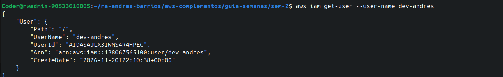
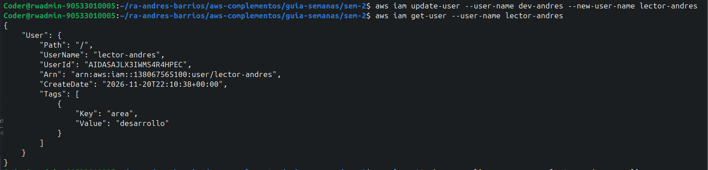
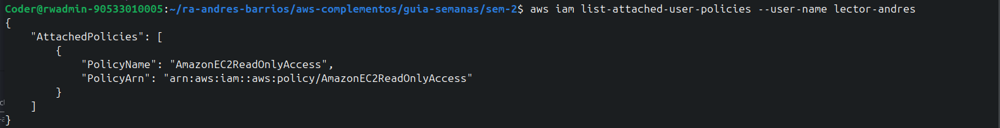
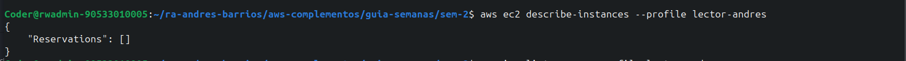
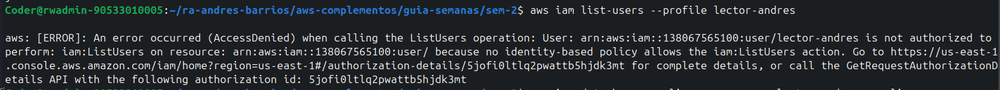
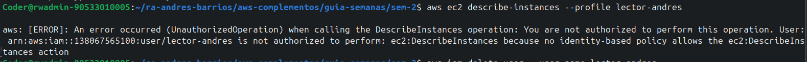
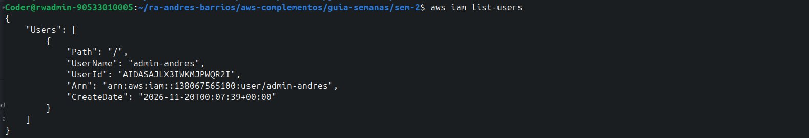

## Evidencias

### Paso 3

### Paso 6

### Paso 8

### Paso 12

### Paso 13

### Paso 15

### Paso 19

## Respuestas
¿Qué podía hacer el usuario justo después de crearlo, antes de adjuntarle una política? ¿Por qué?  
- Nada, un usuario creado nace con los permisos para ejecutar cualquier recurso denegados por defecto.  

En el error del paso 13, ¿qué tres datos te dice el mensaje?
- El primero que `An error occurred (AccessDenied)`, el segundo a`rn:aws:iam::138067565100:user/lector-andres is not authorized`, y el tercero `because no identity-based policy allows the iam:ListUsers action`

¿Por qué cambió el `Arn` al renombrar el usuario?
- Porque el Arn es un identificador unico de ese recurso por lo que al cambiar el nombre del usuario también cambia el ARN, aunque su UserId interno se mantiene.

¿Por qué AWS obliga a borrar las llaves antes de borrar el usuario?
- Para evitar credenciales activas que luego seria difícil su rastreo e incluso evitar borrados accidentales en automatizaciones o scripts.

¿Qué pasaría si le hubieras dado `AdministratorAccess` en vez de solo lectura? ¿En qué caso real estaría justificado?
- Le otorgaria control total sobre prácticamente todos los servicios y recursos de AWS. y estaria justificado porque hace respaldo ante emergencias y trazabilidad individual, evitando depender de una sola persona o compartir una misma cuenta.