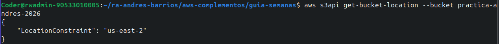
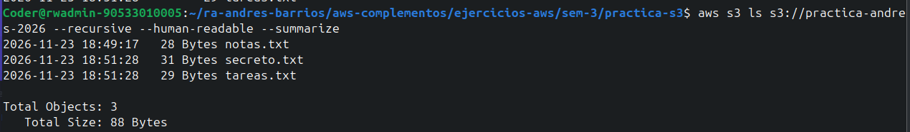
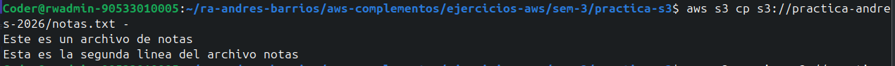
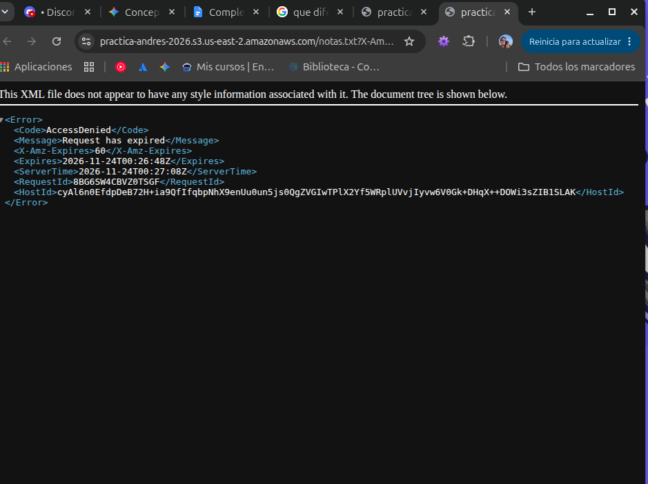
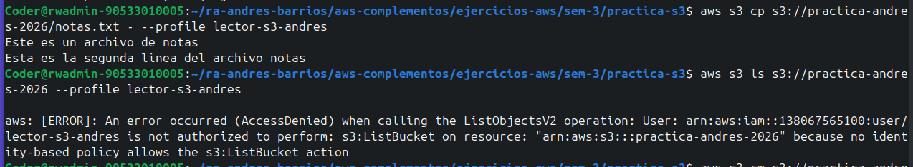
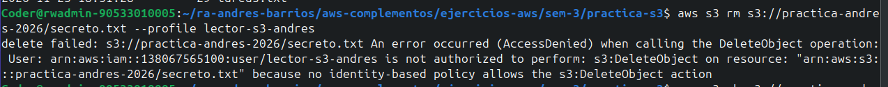
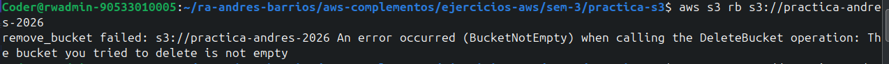
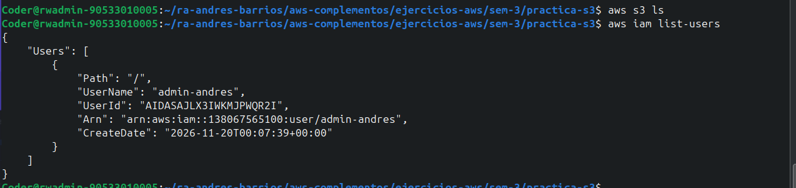

## Evidencias

### paso 3

### paso 7

### paso 13

### paso 16

### paso 21 y 22

### paso 23

### paso 24

### paso 29

## Reflexión
1. ¿Por qué el nombre de tu bucket tuvo que ser distinto al de tus compañeros si cada uno tiene su propia cuenta?  
- porque el bucket es unico en todo aws, por eso cada cuenta tiene el suyo propio si no devuleve error por bucket duplicado.  

2. El usuario del paso 21 pudo leer un archivo, pero en el paso 22 no pudo ver la lista. ¿Qué acción le faltaba en la política?
- falto la politica para acceder al contenido del bucket `s3:ListBucket`.

3. En la política, ¿qué significa el `/*` al final del `Resource`? ¿Qué pasaría si se quitara?
- Se refiere al acceso de lectura a todos los objetos del bucket

4. ¿En qué se diferencia compartir un archivo con un enlace temporal de hacer público el bucket?

- El compartir un archivo temporal lo mantiene privado, en contraste con modificar el accesso del bucket a publico

5. Según el modelo de responsabilidad compartida, si alguien deja un bucket público con datos de clientes, ¿de quién es la responsabilidad?
- del cliente mismo
