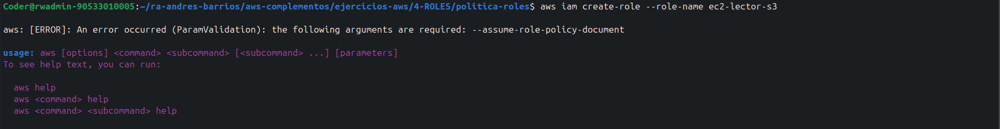
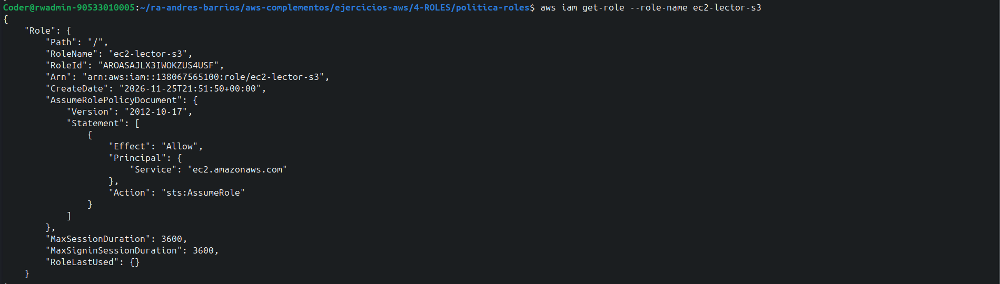
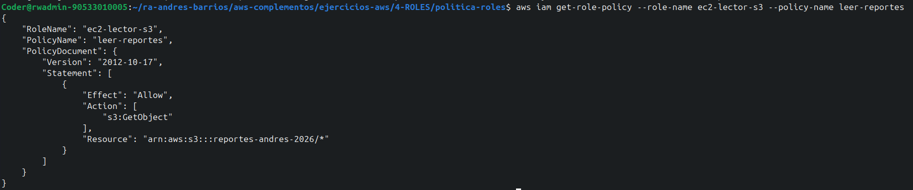
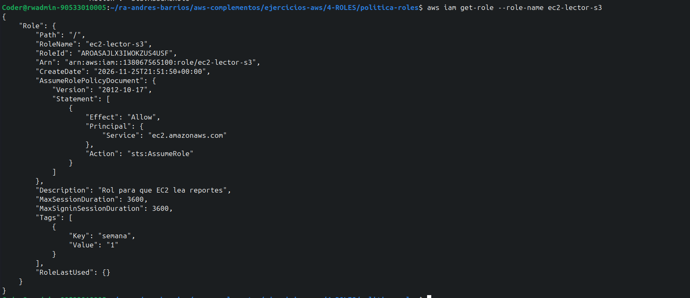
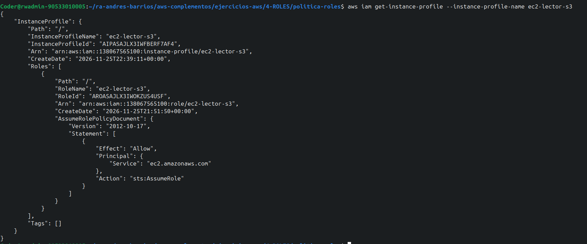
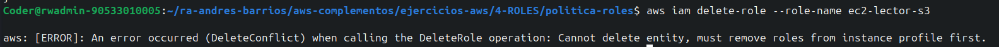

## Evidencias

### Paso 7

### Paso 9

### Paso 13

### Paso 16

### Paso 19

### Paso 20

## Reflexion

1. ¿Qué diferencia hay entre la política de confianza y la política de permisos? ¿Qué pasaría si el rol tuviera solo una de las dos?
- En la politica de confianza se define la quien asumira el rol y ña de permiso que acciones tendra Y daria un error de validacion de parametros al solo poner una de las 2 ya que ambas son complementarias

2. ¿Por qué es más seguro que la instancia use un rol en vez de guardar una llave de acceso con `aws configure`?
- Porque es una mala practica y ademas no esta sujetas a credenciales fijas que estan alojadas en el disco duro aparte que los roles tienen un limite de tiempo el cual puede ser asumido.

3. Con la política `leer-reportes`, ¿la instancia podrá listar el contenido del bucket? ¿Y borrar `reporte.txt`? Explica por qué.
- No, solamente tiene permitido esa accion, para hacer tal cosa se tendria que agregar mas politicas de borro y listado de objetos

4. En el error del paso 20, ¿qué le falta por hacer antes de poder borrar el rol?
- se debe sacar el rol del perfil de instancia para despues eliminar las politicas asociadas y ya eliminarlo

5. Si mañana la instancia también necesita subir archivos al bucket, ¿qué cambiarías y en cuál de los dos archivos?
- añadiria politica para subir objetos al bucket en `"Action"` en la politica del archivo [permisos.json](politica-roles/policy/permisos.json)