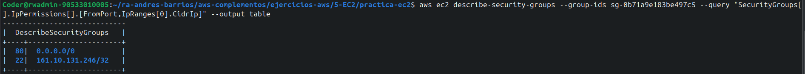
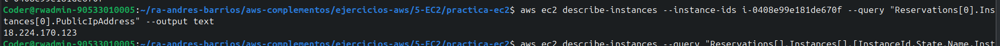
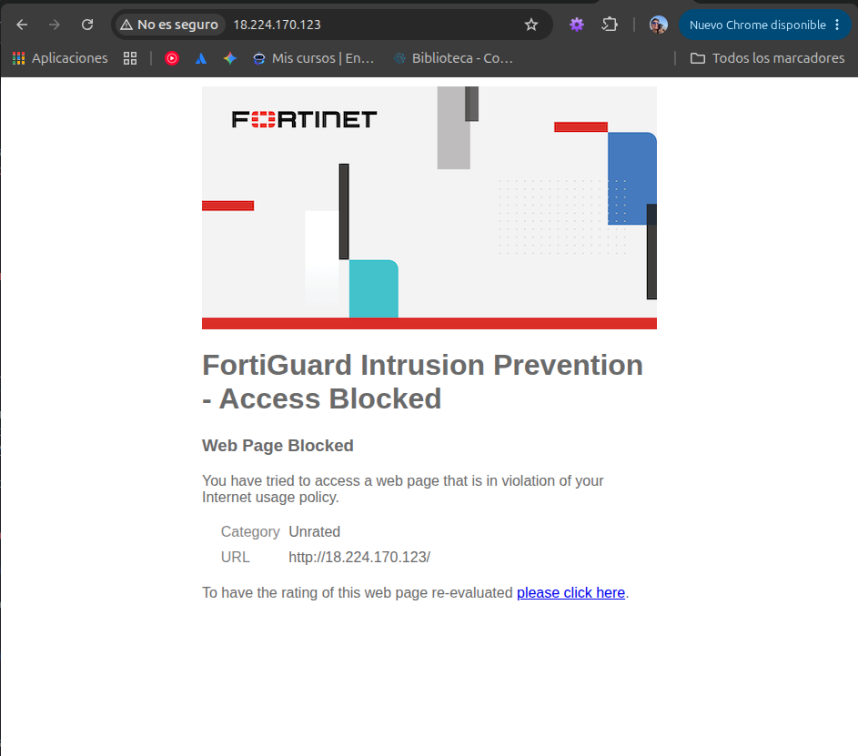
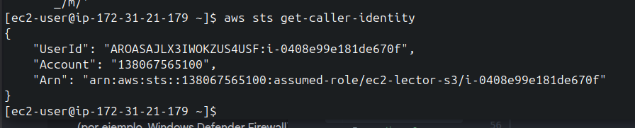
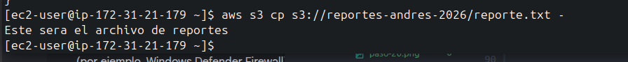
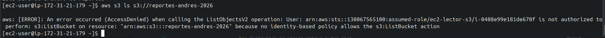
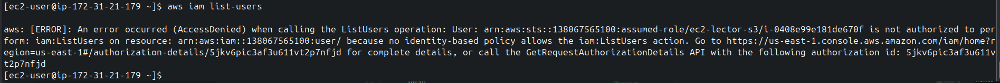
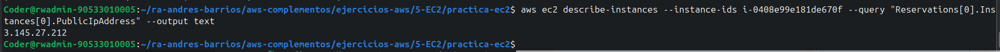
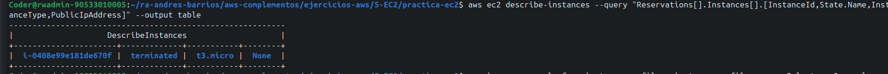

## Evidencias

### Paso 12

### Paso 16

### Paso 17

### Paso 20

### Paso 21

### Paso 22

### Paso 23

### Paso 27

### Paso 31

Contenido de `inicio.sh` [aquí](practica-ec2/scripts/inicio.sh)

## Reflexion

1. En el paso 20, la instancia responde con un rol y no con un usuario. ¿De dónde sacó esas credenciales si nunca corriste `aws configure`?
- De la EC2, el cual entrega credenciales temporales generadas por AWS STS a partir del Instance Profile ec2-lector-s3

2. ¿Por qué el puerto 80 puede estar abierto a todo internet y el 22 no?
- Porque el puerto 80 está pensado para recibir tráfico web público de usuarios y navegadores. El puerto 22 da acceso administrativo directo al sistema operativo por SSH y conviene restringirlo a la IP propia /32

3. La instancia pudo leer `reporte.txt` pero no listar el bucket. ¿Dónde se decidió eso?
- Se decidio al darle la politica de permisos en el role antes de ser ligado al perfil de instancias y de solo tener la accion de leer el contenido s3:GetObject

4. ¿Por qué cambió la IP pública al apagar y encender? ¿Qué problema traería eso en un sitio web real?
- Cambia porque las IP públicas dinámicas se reasignan al detener y encender la instancia, y en un sitio web real esto haría que el dominio apunte a una dirección equivocada o deje de responder.

5. EC2 es infraestructura como servicio (IaaS). En esta práctica, ¿qué fue responsabilidad tuya y qué fue responsabilidad de AWS?
- AWS fue responsable de la infraestructura física, mientras que yo fui responsable de configurar la red y el acceso.

6. Para tener este mismo servidor en una oficina, sin la nube, ¿qué habrías tenido que comprar y configurar?
- Toda su infraestructura, como los servidores, hardware, entorno optimo para operar las 24 h del dia y no solo eso configurar redes para la seguridad de la informacion, administrarla manualmente para su correcta logistica
